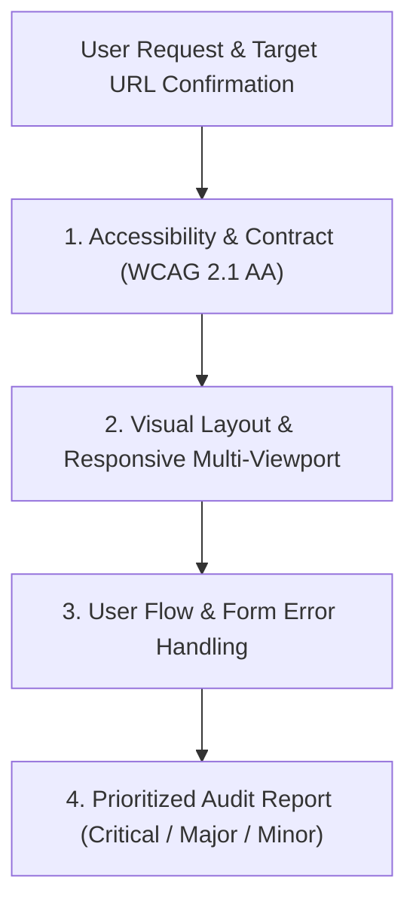

# UI/UX Rigorous Auditing Skill

This skill guides automated, rigorous UI/UX audits of URLs or screens in the LexiNote project using the **Playwright MCP Server**.

---

## ⚠️ Repository Execution Policy (MANDATORY)

Per `AGENTS.md`:
- **DO NOT** launch browsers or navigate to URLs unless explicitly requested or confirmed by the user.
- **DO NOT** execute production builds autonomously.
- Always confirm the target URL / port with the user before initiating an audit run.

---

## Audit Workflow Overview

When requested to audit a URL or screen:



---

## Phase 1: Accessibility & Contract (WCAG 2.1 AA)

### 1.1 Contrast Ratio Check
- **Standard**:
  - Regular body text: minimum **4.5:1** contrast ratio against background.
  - Large text (≥ 18pt / 24px, or ≥ 14pt / 18.66px bold): minimum **3.0:1** contrast ratio.
- **Procedure**:
  - Run the evaluation script via `playwright_evaluate`:
    ```javascript
    // Use the bundled script in ./scripts/wcag-contrast-audit.js
    ```
  - Flag any text failing these ratios with its computed foreground and background colors, font size, and CSS selector.

### 1.2 Interactive Element Accessible Names
- **Standard**:
  - All interactive elements (`<button>`, `<a>`, `<input>`, `<select>`, `<textarea>`, `[role="button"]`) must have a clear accessible name (`aria-label`, `aria-labelledby`, inner text, `title`, or `alt` text on child icons/images).
  - Icon-only buttons (e.g. trash icon, edit icon, close icon) must never have empty accessible text.

### 1.3 Focus State & Keyboard Navigation
- **Standard**:
  - When navigating using the `Tab` key, active interactive elements must show a distinct, high-contrast focus outline or ring (`outline`, `box-shadow`, or `ring`).
- **Procedure**:
  - Call `playwright_press_key` with `{ key: "Tab" }` sequentially across elements.
  - Evaluate `document.activeElement` and check `getComputedStyle(document.activeElement).outline` or border/box-shadow changes.

---

## Phase 2: Visual Layout & Responsive Check

### 2.1 Multi-Viewport Screenshots
Capture full-page screenshots at 3 canonical viewports:

| Viewport | Dimensions (W x H) | Preset / Resize Argument | Screenshot Output |
| :--- | :--- | :--- | :--- |
| **Mobile** | `375 x 812` | `{ width: 375, height: 812 }` or device: `'iPhone 13'` | `mobile-fullpage.png` |
| **Tablet** | `768 x 1024` | `{ width: 768, height: 1024 }` or device: `'iPad Pro 11'` | `tablet-fullpage.png` |
| **Desktop** | `1440 x 900` | `{ width: 1440, height: 900 }` or device: `'Desktop Chrome'` | `desktop-fullpage.png` |

**Playwright MCP Commands**:
1. `playwright_resize`:
   ```json
   { "width": 375, "height": 812 }
   ```
2. `playwright_screenshot`:
   ```json
   { "name": "audit-mobile-375x812", "fullPage": true, "savePng": true }
   ```

### 2.2 Horizontal Overflow Check
- Verify that `document.documentElement.scrollWidth <= document.documentElement.clientWidth`.
- Run [./scripts/overflow-and-obscuration.js](./scripts/overflow-and-obscuration.js) via `playwright_evaluate` to extract all elements extending beyond the right viewport edge.

### 2.3 CTA & Button Obscuration Check
- Ensure sticky headers, bottom navigation bars, or floating toast/banner overlays do not overlap primary Call-To-Action (CTA) buttons.
- Execute `document.elementFromPoint(x, y)` at button centers to ensure the button is directly interactive and not obstructed by another z-index layer.

---

## Phase 3: User Flow & Error Handling

### 3.1 Form Validation Testing
1. **Empty Submission**:
   - Locate forms and trigger submit buttons without entering required fields using `playwright_click`.
   - Verify client-side prevention and error indicators.
2. **Invalid Input Submission**:
   - Fill inputs with malformed data (e.g. invalid email format, passwords violating length criteria) using `playwright_fill`.
   - Submit and verify reactive validation.

### 3.2 Error Message Quality Evaluation
- **Proximity**: Errors must appear adjacent to the invalid input field, not solely in a distant banner.
- **Styling**: Distinct visual cues (e.g. red/crimson border, alert icon, error color with sufficient contrast).
- **Clarity**: Actionable guidance explaining how to resolve the error rather than generic failure messages.

---

## Phase 4: Structured Reporting

Every audit report must be organized into 3 severity levels:

### Severity Criteria
1. 🔴 **Critical**:
   - Blocks core user journey or makes functionality inaccessible (e.g., CTA completely obscured or unclickable, broken form validation blocking valid submission).
2. 🟠 **Major**:
   - Poor user experience or strict WCAG 2.1 AA violation (e.g., contrast below 4.5:1 on key text, icon button without accessible name, unintentional horizontal scrollbar on mobile).
3. 🟡 **Minor**:
   - Cosmetic issues, slight spacing irregularities, subtle visual inconsistencies.

### Required Report Item Structure
For each identified issue, provide:
- **Severity**: Critical / Major / Minor
- **Category**: Accessibility / Layout / Form Error / Responsiveness
- **Specific DOM Selector**: E.g. `form#register-form button[type="submit"]`
- **Observed vs Expected**: Detail what failed and the exact specification violated
- **Direct Code Fix**: Direct HTML / CSS snippet ready to apply

Refer to [./references/audit-report-template.md](./references/audit-report-template.md) for the complete markdown report structure.

---

## Playwright MCP Tool Quick Reference

| MCP Tool | Purpose | Key Parameters |
| :--- | :--- | :--- |
| `playwright_navigate` | Open application URL | `url`, `browserType: "chromium"`, `width`, `height`, `headless` |
| `playwright_resize` | Switch viewport / device preset | `width`, `height` OR `device`, `orientation` |
| `playwright_screenshot` | Capture full-page / element image | `name`, `fullPage: true`, `selector`, `savePng: true` |
| `playwright_evaluate` | Run in-browser audit scripts | `script` |
| `playwright_fill` | Input form data | `selector`, `value` |
| `playwright_click` | Trigger buttons / links | `selector` |
| `playwright_press_key` | Keyboard Tab navigation | `key: "Tab"`, `key: "Enter"` |
| `playwright_console_logs`| Inspect console errors / warnings | None |
| `playwright_close` | Cleanly close browser session | None |

